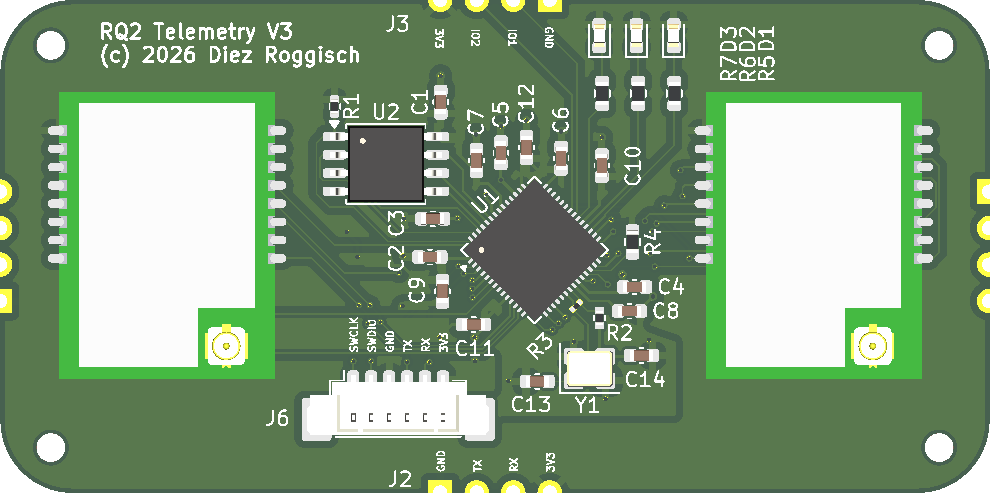
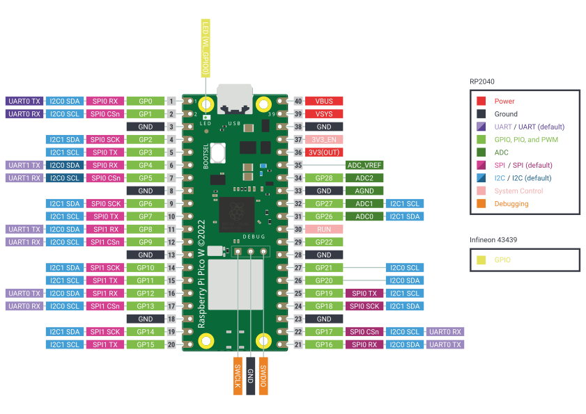

#+STARTUP: inlineimages showall
* Dual Carrier Board

** PCB
*** Aisler

 - [[https://community.aisler.net/t/2-layer-1-6mm-35-m-enig-design-rules/3732][Design rules]].

** Breadboard Setup

*** E28-2G4M20SX

|------------+---------------------+----------|
| Module Pin | Breakout Pin Number | Function |
|------------+---------------------+----------|
|          1 |                  17 | 3V3      |
|          2 |                  18 | GND      |
|          3 |                  19 | SPI TX   |
|          4 |                  20 | SPI RX   |
|          5 |                  21 | SPI CLK  |
|          6 |                  22 | SPI CS   |
|          7 |                  23 | GND      |
|          8 |                  24 | RX_EN    |
|          9 |                   1 | TX_EN    |
|         10 |                   2 | GND      |
|         11 |                   3 | NRST     |
|         12 |                   4 | BUSY     |
|         13 |                   5 | IRQ      |
|         14 |                   6 | X        |
|         15 |                   7 | X        |
|         16 |                   8 | GND      |
|------------+---------------------+----------|

*** RP2040/PicoW

|------------+-----------+-------------|
| RP2040 GIO | PicoW Pin | Function    |
|------------+-----------+-------------|
|          2 |         4 | SPI0_CLK    |
|          3 |         5 | SPI0_TX     |
|          4 |         6 | SPI0_RX     |
|          5 |         7 | SPI0_CS     |
|          6 |         9 | LORA1_IRQ   |
|          7 |        10 | LORA1_BUSY  |
|          8 |        11 | LORA1_NRST  |
|          9 |        12 | LORA1_TX_EN |
|         10 |        14 | LORA1_RX_EN |
|------------+-----------+-------------|
|         11 |        15 | SPI1_TX     |
|         12 |        16 | SPI1_RX     |
|         13 |        17 | SPI1_CS     |
|         14 |        19 | SPI1_CLK    |
|         15 |        20 | LORA2_RX_EN |
|         16 |        21 | LORA2_IRQ   |
|         17 |        22 | LORA2_BUSY  |
|         18 |        24 | LORA2_NRST  |
|         19 |        25 | LORA2_TX_EN |
|------------+-----------+-------------|

*** lora-phy driver implementation

**** RadioLib commands

OpCode: GetPacketType -> [03, 00, 00, ]
OpCode: GetPacketType -> [03, 00, 00, ]
OpCode: ReadRegister -> [19, 09, 3C, 00, 00, ]
OpCode: GetStatus -> [C0, 00, 00, ]
OpCode: GetPacketType -> [03, 00, 00, ]
OpCode: GetPacketType -> [03, 00, 00, ]
OpCode: GetPacketType -> [03, 00, 00, ]
OpCode: SetPacketParams -> [8C, 14, 00, FF, 20, 40, 00, 00, ]
success!
[SX1280] Transmitting packet ... OpCode: GetPacketType -> [03, 00, 00, ]
OpCode: NoOp -> [00, ]
OpCode: SetStandby -> [80, 00, ]
OpCode: GetPacketType -> [03, 00, 00, ]
OpCode: GetPacketType -> [03, 00, 00, ]
OpCode: SetPacketParams -> [8C, 14, 00, 0F, 20, 40, 00, 00, ]
OpCode: SetTxParams -> [8E, 1C, 80, ]
OpCode: SetBufferBaseAddress -> [8F, 00, 00, ]
OpCode: WriteBuffer -> [1A, 00, 48, 65, 6C, 6C, 6F, 20, 57, 6F, 72, 6C, 64, 21, 20, 23, 30, ]
OpCode: SetDioIrqParams -> [8D, 40, 01, 00, 01, 00, 00, 00, 00, ]
OpCode: SetTx -> [83, 00, 00, 00, ]

**** lora-phy translation

***** impl Lora<RK, DLY>::init

  - [X] reset
  - [X] ensure_ready
  - [X] set_standby
  - [ ] ensure_ready can't read the FirmwareVersions string, as it's used later as well. Try and make it work after reset or so.

***** impl Lora<RK, DLY>::prepare_for_tx

    - [X] self.prepare_modem(mdltn_params.frequency_in_hz).await?;
    - [X] self.radio_kind.set_modulation_params(mdltn_params).await?;
    - [ ] self.radio_kind.set_tx_power_and_ramp_time(output_power, Some(mdltn_params), true).await?;
    - [ ] self.radio_kind.ensure_ready(self.radio_mode).await?;
    - [ ] if self.radio_mode != RadioMode::Standby { self.radio_kind.set_standby().await?; self.radio_mode = RadioMode::Standby;  }
    - [ ] tx_pkt_params.set_payload_length(buffer.len())?;
    - [ ] self.radio_kind.set_packet_params(tx_pkt_params).await?;
    - [ ] self.radio_kind.set_channel(mdltn_params.frequency_in_hz).await?;
    - [ ] self.radio_kind.set_payload(buffer).await?;
    - [ ] self.radio_mode = RadioMode::Transmit;
    - [ ] self.radio_kind.set_irq_params(Some(self.radio_mode)).await?;
